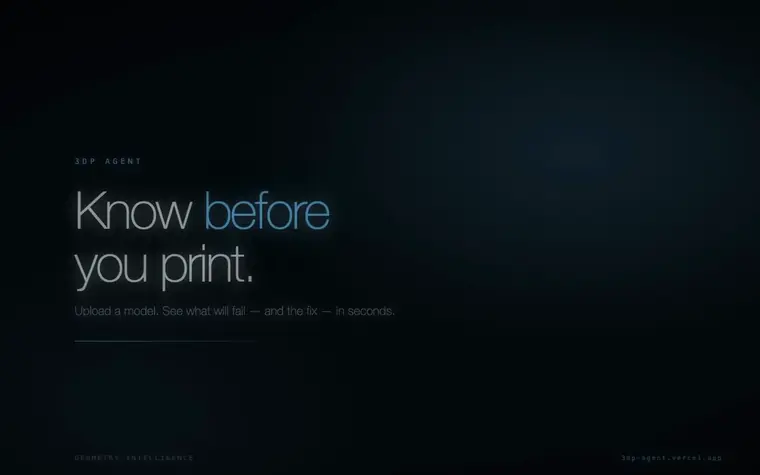
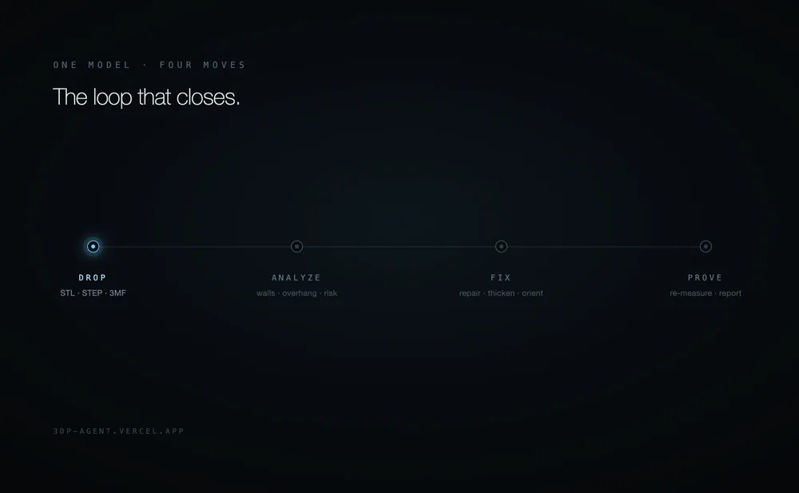
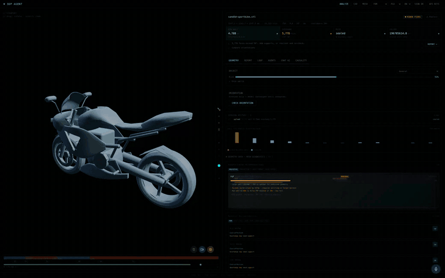
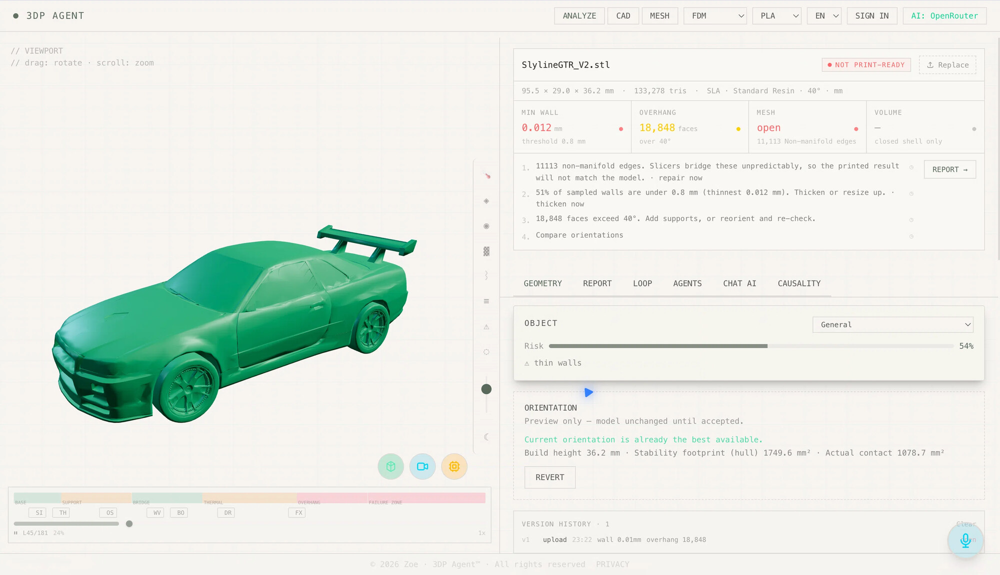
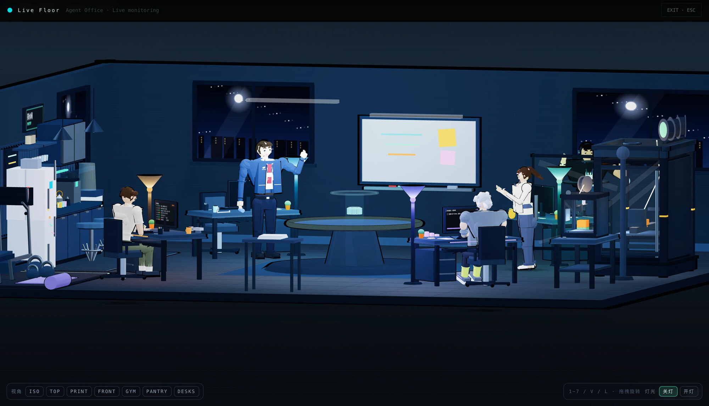
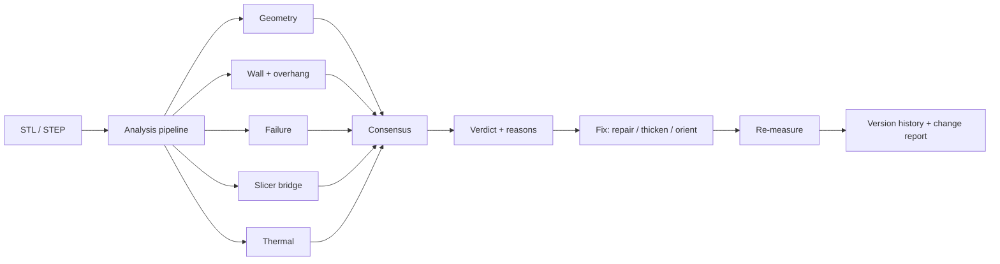

<div align="center">

<br />

**3DP AGENT**

# Know before you print.

Upload a model. See what will fail, why it will fail,<br />
and the cheapest change that fixes it — before the first layer.

<br />

[**Live demo**](https://3dp-agent.vercel.app) &nbsp;·&nbsp; [**Watch the 19-second tour**](docs/media/ad.mp4) &nbsp;·&nbsp; [**Run locally**](#run-locally)

<br />

[](https://github.com/BougieZoe/3DP-Agent-/actions/workflows/ci.yml)


<br />

<a href="docs/media/ad.mp4"></a>

<sub><b>▶ excerpt</b> (animated WebP, plays inline) · <a href="docs/media/ad.mp4">watch the full 19-second tour</a></sub>

</div>

<br />

---

<div align="center">
  
  <br />
  <sub>Drop → analyse → fix → prove. The loop closes only when a second measurement agrees.</sub>
</div>

<br />

## One model, four moves

Most tools stop at *"something is wrong."* 3DP Agent closes the loop.

| &nbsp; | Move | What you get |
|:--:|---|---|
| **01** | **See** | A verdict — `BLOCKED` / `REVIEW` / `PASS` — not a mysterious score. |
| **02** | **Understand** | Every deduction with its measured value: *13 boundary edges −30, 21% flipped normals −15*. |
| **03** | **Fix** | Real geometry operations: close the shell, thicken the walls, compare orientations — then re-measure. |
| **04** | **Prove** | A version history and a one-page change report: *0.600 → 0.800 mm, open → sealed*. |

<br />

<div align="center">
  
  <br />
  <sub><b>Overhang, in colour.</b> Turn the layer on and the part keeps moving — 5,778 faces over 50° light up where the print would sag.</sub>
</div>

<br />

<div align="center">

| | before | after |
|---|:--:|:--:|
| **Min wall** | 0.600 mm | **0.800 mm** |
| **Shell** | open · 2 non-manifold edges | **sealed · 0 boundary edges** |
| **Volume** | withheld (open shell) | **689,323 mm³** |
| **Verdict** | NOT PRINT-READY | **No blocking geometry issue found** |

<sub>Same part, same camera, one click. Numbers are what the app measured, not a promise.</sub>

</div>

<br />

---

## Why it feels different

**The verdict comes first.** Not a dashboard of twelve panels — a single answer with
a drill-down for people who want to argue with it. The gate is a hard-block check,
so it says `BLOCKED` and lists the arithmetic instead of printing `0/100`.

**Every claim carries its measurement.** Wall numbers come from ray-cast sampling at
the same percentile the headline uses. Causality shows `HIGH · 25 markers` rather than
a fabricated `100%`. Where a number is a rule weight and not a probability, it is
presented as a band.

**Fixes are measured, not promised.** A thickening that regresses the wall is
**discarded**, recorded as `discarded` with its measured value, and the original is
kept. A change is only committed when a second analysis proves it improved something.

<br />

<div align="center">
  
  <br />
  <sub>Light theme, material preview on — 133,278 triangles, <b>0.012&nbsp;mm</b> walls, 18,848 faces over 40°,
  11,113 non-manifold edges, and the orientation panel already says the current pose is the best one.<br />
  Theme and material preview are one click each in the viewport toolbar.</sub>
</div>

<br />

---

## The report is an argument, not a wall of text

```
BLOCKED   QUICK CHECK · GATE

Why this result
· Mesh is not watertight (13 boundary edges)      −30 pts
· 4 hole(s) in the shell                          −32 pts
· Inconsistent normals on 21% of faces            −15 pts
  +2
  gate score — a hard-block check, not a rating      0/100

CHANGES SINCE UPLOAD
· Min wall      0.20 → 0.90 mm (+0.70)
· Shell         open → sealed
```

<br />

<div align="center">
  <sub><b>Import note.</b> A Sand3D <code>.usda</code> scene goes straight in — two flags in <code>scripts/usda-to-stl.py</code> and it lands in a printable pose.<br />
  The body stays neutral on purpose; the cube button switches on a <b>material preview</b> swatch without touching any measurement.</sub>
</div>

<br />

---

## A team, not a single opinion

Four specialists review the same model independently, then reconcile their findings
into one weighted verdict — with the disagreements kept visible.

| Agent | Responsibility |
|---|---|
| **Geometry analyst** | Topology, manifoldness, wall distribution |
| **Printability scorer** | Manufacturing readiness for the chosen process |
| **Failure predictor** | Where and why this print fails first |
| **Optimization advisor** | The cheapest change that removes the risk |

<br />

<div align="center">
  
  <br />
  <sub>The Live Floor, fullscreen: four agents at their desks, each reporting what it found.<br />
  Orbit the room, or jump to a preset view — ISO, TOP, PRINT, FRONT, GYM, PANTRY, DESKS.</sub>
</div>

<br />

---

## Three workspaces, one pipeline

| Workspace | Input | Outcome |
|---|---|---|
| **ANALYZE** | STL · STEP · 3MF | Printability, geometry, causality, report, change history |
| **CAD** | Natural-language intent | Parametric build123d → STEP / STL / 3MF |
| **MESH** | Text or mesh files | Generate, repair, decimate, orient, place on plate |

<br />



<br />

---

## Engineering notes

**Analysis** runs in a Web Worker with a confidence gate; results are
per-module, so a failed module degrades to a labelled placeholder instead of
poisoning the verdict. Wall thickness is ray-cast against a BVH; overhang comes
from face normals against the process threshold.

**Fixes** come in two tiers. The browser does a measured local offset guided by
thin-wall samples. The bridge does a true solid offset — Minkowski sum with a
ball — natively, which is ~6× faster than WASM and the only implementation that
guarantees a wall gain:

| triangles | runtime | result |
|---:|---:|---|
| 5,096 | 1.6 s | wall 0.490 → 0.800 mm, bbox +0.300 mm (= 2δ) |
| 20,376 | 5.9 s | bbox +0.300 mm |

Both invariants are checked by `scripts/verify-bridge-thicken.py`; the design and
the HTTP contract live in [docs/bridge-thicken.md](docs/bridge-thicken.md).

**Bridge endpoints** (dev, proxied to `:3001`):

| Endpoint | Purpose |
|---|---|
| `POST /api/mesh/thicken` | True solid offset, 80k-triangle budget |
| `POST /api/mesh/process` | Diagnostics, repair, decimate, place on plate |
| `POST /api/cad/generate` | Text → build123d → STEP + STL (sandboxed) |
| `POST /api/slice` | STL → G-code via PrusaSlicer / OrcaSlicer |
| `POST /api/step` | STEP → geometry + metadata |
| `GET /health/detailed` | Includes a `thicken` capability check |

**Stack.** React 19 · TypeScript (strict) · Vite 7 · Three.js 0.184 · React Three
Fiber · Tailwind 4 · Web Workers · Electron · manifold-3d · PrusaSlicer / OrcaSlicer.

**Verification.** `tsc --noEmit`, 884 tests across 117 files, and a production
build — enforced by CI on every push.

<br />

---

## Run locally

Two processes: the web app, and the API/bridge server.

```bash
git clone https://github.com/BougieZoe/3DP-Agent-
cd 3DP-Agent-
pnpm install

# Terminal 1 — web app        → http://localhost:3000
pnpm dev

# Terminal 2 — API + bridges  → http://localhost:3001
pnpm dev:server
```

Bridge features (true thicken, repair, slicing) need their Python dependencies:

```bash
pip install -r requirements.txt        # trimesh, pymeshfix, manifold3d
```

Without them the app still runs — fixes fall back to the browser and the
`thicken` health check reports a warning instead of failing readiness.

**Slicer (optional, for real G-code):** install PrusaSlicer or OrcaSlicer; both are
auto-discovered. **STEP input** needs no setup (OpenCASCADE WASM ships with the app).

<br />

---

## Roadmap

- [x] Slicer integration — PrusaSlicer, OrcaSlicer
- [x] STEP input via OpenCASCADE WASM
- [x] Material-specific thermal analysis
- [x] PDF reports, batch comparison, cost handoff
- [x] Gate verdicts with machine-readable reasons
- [x] Measured fix loop: repair → thicken → re-measure
- [x] Version history and one-page change reports
- [ ] Manufacturing knowledge graph
- [ ] Historical failure memory across projects

<br />

## Who it is for

Product designers · mechanical engineers · manufacturing teams · prototyping labs —
anyone who has ever asked *"will this actually print?"*

<br />

## Legal

This project is proprietary software. **3DP Agent™** and its original source code,
UI design, documentation, assets, prompts, workflows, and 3D-processing logic are
owned by Zoe. All rights reserved. No copying, redistribution, modification, or
derivative works without prior written permission. Third-party libraries remain
subject to their respective licenses — see [COPYRIGHT.md](COPYRIGHT.md).

<br />

<div align="center">

<sub>If 3DP Agent saves you a failed print, give it a star.</sub>

</div>
